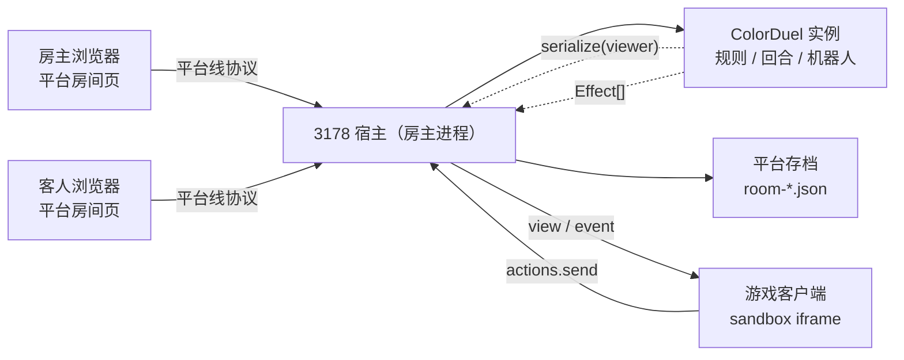
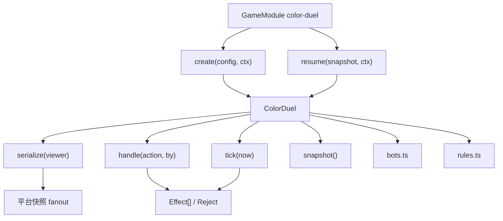
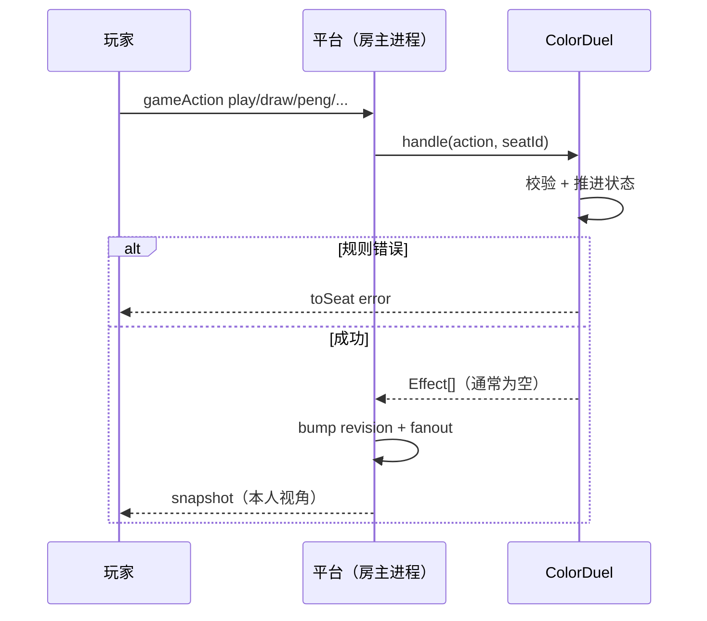
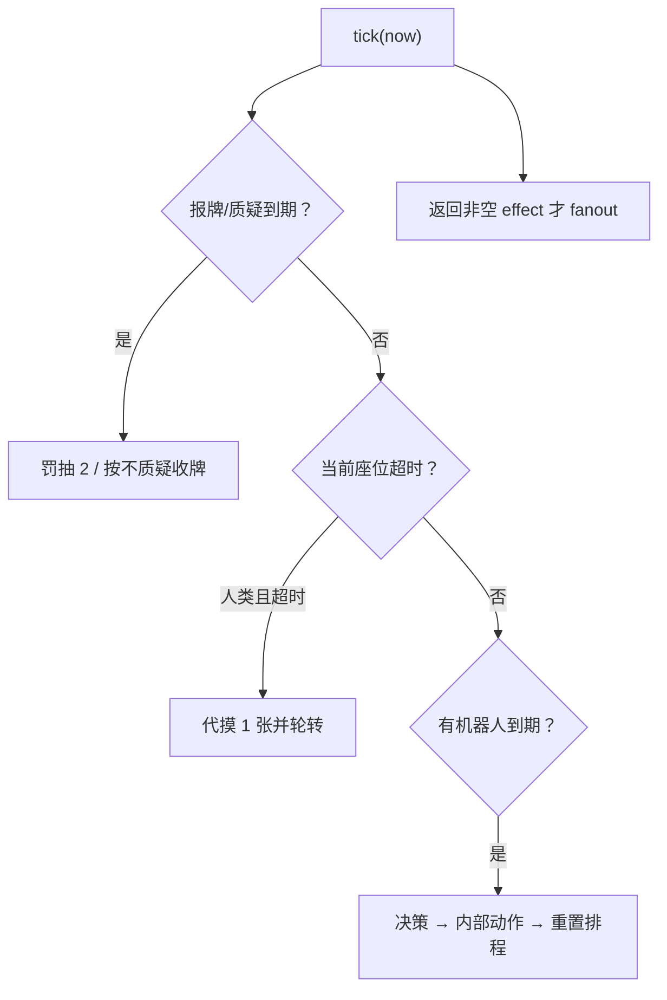

# 变色对决 · 方案架构设计

> 写给维护和评审的人：目标、约束、架构、状态机、与 3178 平台的接缝、设计决策与边界都在这里。
> 最近更新：2026-10-30

## 1. 文档目录

| 文档 | 阅读对象 | 内容 |
|---|---|---|
| [README.md](README.md) | 玩家 / 开发者 | 游戏介绍、规则摘要、安装与开发、配置项、限制 |
| [DESIGN.md](DESIGN.md)（本文） | 开发者 / 评审 | 目标与约束、架构、状态机、计时与机器人、平台接缝、设计决策 |
| [CONTEXT.md](CONTEXT.md) | 维护者 / 交接 agent | 当前状态、下一步、坑与验证命令、交接记录 |

## 2. 设计方向

### 2.1 目标

在不改变玩法语义的前提下，把原来的独立联机版「变色对决」重构为 3178 平台的游戏包：

- 玩法只依赖 `@lizardon386/game-sdk` 的 `GameModule` / `GameInstance` / `Effect[]`；
- 房间、座位、房主权限、票据、断线宽限、聊天、存档全部交回平台；
- 客户端变成单文件 ESM，跑在 `sandbox=allow-scripts` 的 iframe 里，只渲染和发动作；
- 规则开关通过平台的 `ruleConfig` 声明式表单呈现，座位颜色/电脑难度走 `seatOptions`，规则资料通过 `reference` 懒加载。

### 2.2 约束

- **服务端是唯一权威**：合法出牌、回合、罚值、质疑、胜负都在房主进程里判定。
- **不碰传输**：游戏不持有 socket，不写本机存储，不读票据。
- **计时只能用 `ctx.now()` + `tick()`**：不用 `setTimeout`，否则重启、快进和测试都不可控。
- **手牌按视角裁剪**：`serialize(viewer)` 只给本人手牌，观战和对手只拿张数；质疑确认前不泄露。
- **界面必须适配 600×360**：平台对局区在窄窗口下就这么大；宽屏只是同一套布局拉伸。
- **单文件客户端**：交给沙箱的 `client.js` 不保留任何 `import`，CSS 在构建时内联。

### 2.3 验收

| 验收项 | 通过标准 | 证据 |
|---|---|---|
| 规则正确 | 牌堆 152/136/120、接龙、质疑、碰、甩色、0/7、报牌、上限都有测试 | `npm test` |
| 机器人能自走 | 1 真人 + 3 电脑在模拟时钟内打完一局，牌 id 不重复 | `test/bots.test.mjs` |
| 视角隐私 | 观战和对手拿不到手牌；质疑确认前只有人名与张数 | `test/game.test.mjs` |
| 存档恢复 | `snapshot()` → `resume()` 后手牌、牌堆、回合一致；版本不符拒绝 | 同上 |
| 平台契约 | `ruleConfig` / `reference` 通过 SDK 校验；包能过 `bpmap doctor` | `npm test` + `npm run doctor` |
| 真机联调 | 平台加载 `.bpmap`，建房 → 加电脑 → 打完一局 → 再来一局 | 见 CONTEXT「验证」 |

## 3. 运行模式

房主进程里跑平台宿主，游戏的服务端入口被宿主 `import()` 后按房间创建实例；客户端入口在沙箱 iframe 里执行。



游戏实例不读 `games/` 以外的文件，不启动服务，不持有 socket。

## 4. 架构

```text
src/
├─ server/
│  ├─ rules.ts      牌堆、牌型、合法性、罚值、抽牌与补充牌
│  ├─ config.ts     房规归一化（含连字符 key）与计时常量
│  ├─ bots.ts       三档决策（只产出动作，不改状态）
│  ├─ game.ts       GameInstance：状态机、serialize、tick、快照
│  └─ index.ts      GameModule：id/version/ruleConfig/seatOptions/reference
├─ client/
│  ├─ index.ts      mount / onEvent / unmount，布局与动作栏
│  ├─ cards.ts      卡面 DOM 与颜色符号
│  ├─ dialogs.ts    选色 / 换手 / 质疑 / 弃牌 / 摊牌 / 结算
│  ├─ sfx.ts        WebAudio 合成音
│  └─ styles.css    构建时内联进单文件
└─ reference.json   规则资料（平台渲染）
```



### 4.1 GameInstance 生命周期

| 时机 | 平台调用 | 本游戏做什么 |
|---|---|---|
| 房主开局 | `begin()` | 从 `ctx.seats()` 取非观战座位，按 slot 排序，发 7 张，翻首张并结算起手效果 |
| 玩家动作 | `handle(action, by)` | 校验座位、回合、窗口，推进状态；规则错误用 `toSeat` 的 `error` 事件回给本人 |
| 心跳 4Hz | `tick(now)` | 报牌/质疑窗口到期、回合超时代打、机器人排程；有变化才返回 effect |
| 每次 fanout | `serialize(viewer)` | 按视角裁剪；给出相对截止时间与 `deadlineInMs` |
| 存档 | `snapshot()` | 全量 JSON：牌堆、废牌、手牌、窗口、日志、座位 |
| 恢复 | `resume(snapshot, ctx)` | 重建实例，重置窗口，给机器人重新排程 |
| 座位离开 | `onSeatLeave(seat, phase)` | 移出该座位；剩不到 2 人时本局结束（不关房间） |
| 再来一局 | `handle({name:'rematch'})` | 房主在结束时重发牌，房间相位不变 |

## 5. 核心流程

### 5.1 一回合



### 5.2 计时与机器人



- 计时窗口用 `ctx.now()`，由 4Hz 心跳结算，精度 250ms 足够。
- 机器人不用 `setTimeout`；`botDueAt` 记在实例里，`tick` 到点才行动，动作后重新排程。
- 机器人的动作被规则拒绝时按超时处理，避免原地重试卡死。

### 5.3 结束与再来一局

本游戏**不发送 `end` Effect**：`end` 会让平台把房间相位改成 ended 并把玩家踢回大厅。胜利只改游戏内部 `state='ended'`，房间保持 playing；客户端展示结算面板，房主可发 `rematch` 重新发牌。

## 6. 与平台的接缝

### 6.1 快照与隐私

`serialize(viewer)` 只给该座位自己的 `hand`；观战传 `null`，所有 `hand` 都是 `undefined`。质疑窗口只下发 `heldCount` 与可质疑名单，确认质疑后用一次性 `toSeat` 事件把当时的手牌快照发给提问者。

### 6.2 规则表单（ruleConfig）

`GameModule.ruleConfig` 声明 7 个字段；平台在房间的「本局规则」卡渲染，把值放进 `roomCreate.config`。游戏侧仍用 `normalizeConfig` 兜底：非法值回落默认、关接龙连带关质疑、关绝情无上限。

字段 key 必须是 `^[a-z][a-z0-9-]{0,31}$`，所以内部 camelCase 的 `noTurnTimer` 在表单里是 `no-turn-timer`，由 `normalizeConfig` 翻译。

### 6.3 座位选项（seatOptions）

`GameModule.seatOptions` 声明 `difficulty`（仅 ai，easy/normal/cold，默认 easy）和 `color`（host/player/ai，红黄绿蓝，带十六进制色块）。`normalizeSeatOptions(role, slot, raw)` 负责按角色收口、按 `slot` 轮转默认色（1 红 2 黄 3 绿 4 蓝…），非法值回落；平台建座、改选项和重启恢复都会调用。AI 决策逐座读 `seat.options.difficulty`；座位颜色写进 `serialize` 的 `players[].options`，客户端用座位框颜色呈现。改选项走 `hostSeat {op:'setOptions'}`，只房主、只 lobby，平台持久化并广播。

### 6.4 规则资料（reference）

`GameModule.reference = { entry: 'reference.json' }`；平台首次展开面板时按 `/games/color-duel/reference.json` 懒加载，并用 SDK 的 `parseGameReference` 校验。文档只含纯文本与图片，不解析 HTML。

### 6.5 房间头的倒计时

`serialize` 额外给出 `deadlineInMs`（当前回合剩余毫秒），平台的房间头会显示「剩余 N 秒」。游戏界面不画回合倒计时，避免同一屏出现两个秒数；报牌 5 秒与质疑 10 秒的窗口倒计时仍在游戏内显示。

## 7. 关键设计决策

| 决策 | 理由 | 代价 |
|---|---|---|
| 规则层保持纯函数 | 原实现已验证，移植风险最低 | 需要把原 `Room` 的 IO 部分拆掉 |
| 一个 `ColorDuel` 管整局，机器人也在里面 | 平台只给 `handle/tick`，没有独立 AI 通道 | 实例更大，但状态一致性简单 |
| 不用 `end` 收尾，游戏内 rematch | 平台 `end` 会踢回大厅，丢掉「再来一局」 | 房间相位停在 playing，平台侧看不出已结束 |
| 客户端全量重渲染 + 手牌按 id 复用 | 无框架、单文件；手牌不闪、焦点不丢 | 需要手动维护 DOM 差异 |
| 回合计时只看向平台房间头 | 同一屏不出现两个秒数；游戏不重复实现平台已有信息 | 单独预览游戏界面时没有回合计时 |
| 资料放包内 JSON，惰性加载 | manifest 保持小，握手不变重 | 平台多一次请求 |
| 颜色 + 符号双编码 | 色弱与小尺寸都能认 | 卡面多一个小角标 |
| 手牌区限制高度、横向滚动 | 600×360 也能玩 | 牌特别多时要滚动 |

## 8. 已定语义与边界

- **不做**：账号、匹配、排行榜、观战延迟、回放、断线托管策略（平台负责宽限）。
- **不碰**：socket、票据、本机存储、平台相位与座位表。
- **电脑位**：平台只提供座位；行为、节奏由游戏实现，每个 `ai` 座位的难度读自己的 `options.difficulty`，`connected` 不可靠。
- **人类掉线**：平台保留座位；游戏按回合超时代打，重连后继续。
- **观战**：看不到任何手牌；质疑揭示只发给提问者。
- **游戏结束**：内部 `state='ended'`，不关房间；房主可用 `rematch`，其他玩家只能看结算。
- **被拒动作**：规则错误走 `toSeat` 的 `error` 事件（游戏内 toast），平台级错误才用 `Reject`。

## 9. 测试

| 文件 | 覆盖 |
|---|---|
| [test/rules.test.mjs](test/rules.test.mjs) | 牌堆与开关、合法性、抽牌/补充牌、rule-config 与 reference 契约 |
| [test/game.test.mjs](test/game.test.mjs) | 开局、出牌、接龙、质疑、碰、甩色、0/7、报牌、上限、超时、座位离开、存档、rematch、隐私 |
| [test/bots.test.mjs](test/bots.test.mjs) | 机器人自走收敛、牌 id 不重复、PVE/PVP 计时差异 |
| [test/seat-options.test.mjs](test/seat-options.test.mjs) | seatOptions 声明、按 slot 默认色、AI 默认 easy、serialize/resume、逐座难度 |

`npm test` 先 `tsc` 编译到 `dist-ts/`，再用 `node --test` 跑 `.mjs` 测试。

## 10. 工程约束

- 客户端构建必须产出单文件 ESM；CSS 通过 esbuild 的 `text` loader 内联，不能留下 `import`。
- 卡牌高度用 `.cd-root` 上的 `--cd-ch: calc(var(--cd-cw) * 1.42)`，不要写回 `:root`，否则变量在根节点提前求值，卡片会变成正方形。
- `[hidden]` 需要显式 `display:none !important`，否则会被 `.cd-chip{display:inline-flex}` 覆盖。
- 规则错误不要用 `Reject`，否则提示落在平台状态栏，玩家看着牌桌找不到。
- 机器人动作必须让 `tick` 返回非空 effect，平台才会 fanout。
- `reference.json` 与 `ruleConfig` 改动后跑 `npm test`（契约校验）和 `npm run doctor`。
