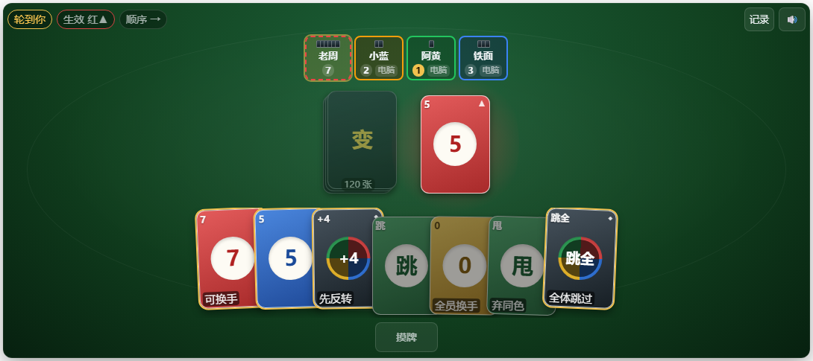

# 变色对决

> 2~8 人联机卡牌游戏：三档电脑、五个规则开关与两段式质疑。
> 游戏包 ID：`color-duel`　版本：0.2.1　最近更新：2026-10-30



## 1. 文档目录

| 文档 | 阅读对象 | 内容 |
|---|---|---|
| [README.md](README.md)（本文） | 玩家 / 开发者 | 游戏介绍、运行平台与依赖、快速开始、规则摘要、规则与座位配置、限制 |
| [DESIGN.md](DESIGN.md) | 开发者 / 评审 | 目标与约束、架构、状态机、计时与机器人、平台接缝、设计决策 |
| [CONTEXT.md](CONTEXT.md) | 维护者 / 交接 agent | 当前状态、下一步、坑与验证命令、交接记录 |

## 2. 这是什么

「变色对决」是一款 2~8 人联机卡牌游戏。玩法源自公有领域的 Crazy Eights 一系，为联机对抗做了强化；卡面、配色与文案为原创。

- **2~8 人**，支持观战；房主可以加电脑位，1 人 + N 电脑即可单机开局。
- **规则开关**：罚牌接龙、罚牌质疑、功能牌拓展、绝情（+6/+10 与手牌上限）、碰。
- **完整规则**：报牌、碰、甩色、0 全员换手、7 指定换手、跳过所有人、反转黑 +4、两段式质疑。
- **三档电脑**：简单、中等、冷酷。

## 3. 运行平台与依赖

本游戏是 [3178 对战平台](https://github.com/Lizardon386/3178-battle-platform) 的游戏包，不能单独运行。平台负责房间、座位、票据、掉线宽限、存盘、聊天和局域网/邀请链接；本包只提供玩法、界面与规则资料，不持有 socket、不写本机存储。

- **平台入口**：平台仓库根目录的 `3178对战平台.bat`（`cli.js shell`）。谁建房，谁的进程就是权威服务器；朋友从局域网列表或邀请链接进房。
- **依赖契约**：`@lizardon386/game-sdk` 0.4.0；游戏包格式 1、API 版本 1、模式 `turn`；本局规则走 `ruleConfig`，座位颜色/电脑难度走 `seatOptions`，规则资料走 `reference`，由平台校验并在房间里渲染。
- **版本闸**：宿主只加载匹配的包格式 / API / 模式，不匹配会拒绝加载。
- **没有账号与匹配**：房间号 + 邀请链接就是门禁，和平台一致。

## 4. 快速开始

### 4.1 装进平台

前置：已经装好 3178 对战平台（见第 3 节）。

```bash
npm install
npm run build
npx bpmap doctor dist-pack
cp dist/color-duel.bpmap <3178 仓库>/games/
```

重启宿主，建房时游戏列表里会出现「变色对决」。规则开关在房间的「本局规则」卡里由房主设置；座位颜色由房主点席位号码牌选择，电脑难度在电脑席位行内下拉；规则资料在「规则与资料」面板里按需加载。

### 4.2 开发

```bash
npm install
npm test               # 规则 / 状态机 / 机器人 / 契约校验
npm run build          # 生成 dist-pack/ 与 dist/color-duel.bpmap
npm run doctor         # bpmap doctor dist-pack
```

也可以用 `node scripts/build.mjs --platform ../3178-battle-platform --start` 一步构建、安装并启动宿主。

## 5. 规则摘要

- 每人 7 张，先出完者获胜。出牌要与生效颜色相同，或与顶牌同数字/同功能；黑牌随时能出。
- 罚牌接龙：被 +N 砸中时可用罚值不小于 N 的牌压回，接不住一次吃下全部并跳过本回合。
- 质疑：吃下含黑色罚牌后可盲选一人质疑。对方有牌可出 → 他罚抽 6 张；确实没牌 → 你多罚 4 张。
- 碰：顶牌是数字牌时，同色同数可以抢下回合；两张相同可以一起碰。
- 0 全员换手，7 指定换手，甩色把其余同色牌一起弃掉，跳过所有人让你再来一回合。
- 只剩 1 张要在 5 秒内报牌，否则罚抽 2 张。
- 绝情开启时手牌上限 20/30/40，回合结束超限必须先弃牌。

完整条目见 [src/reference.json](src/reference.json)，由平台渲染成房间里的「规则与资料」面板。

## 6. 配置项（ruleConfig / seatOptions）

本局规则进房后由房主在「本局规则」卡设置；座位选项在席位行按座位设置。两者都由平台校验、加入者只读。

| 规则字段 | 类型 | 默认 | 说明 |
|---|---|---|---|
| `stack` | 开关 | 开 | 罚牌接龙 |
| `contest` | 开关 | 开 | 罚牌质疑（依赖接龙） |
| `extend` | 开关 | 开 | 功能牌拓展：跳过所有人、甩色、0/7 换手、反转黑 +4 |
| `merciless` | 开关 | 开 | 绝情：+6/+10 与手牌上限 |
| `peng` | 开关 | 开 | 碰 |
| `cap` | 枚举 | 20 | 手牌上限 20 / 30 / 40（仅绝情开启时生效） |
| `no-turn-timer` | 开关 | 关 | 关闭出牌倒计时（仅带电脑位的房间生效） |

| 座位字段 | 类型 | 适用座位 | 默认 | 说明 |
|---|---|---|---|---|
| `difficulty` | 枚举 | 电脑 | 简单 | 简单 / 中等 / 冷酷，每个电脑位独立 |
| `color` | 枚举 | 房主 / 玩家 / 电脑 | 按槽位轮转 | 红 / 黄 / 绿 / 蓝；显示在席位行和游戏内座位框 |

## 7. 使用限制

- **电脑位由游戏驱动**：平台只提供 `ai` 座位，决策与节奏在游戏内完成；房主挂机/退出时按平台规则处理。
- **观战看不到手牌**：状态按座位裁剪，观战视角与对手只能看到张数。

## 8. 许可

MIT，见 [LICENSE](LICENSE)。玩法机制来自公有领域，卡面与文案为原创。
